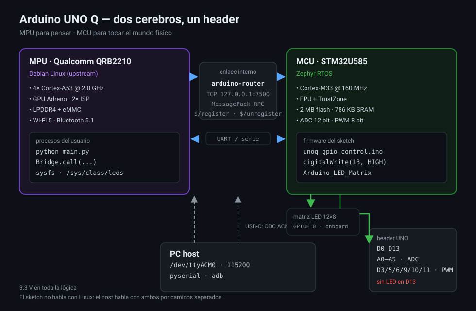

<div align="center">

# UNO Q Lab

**Dos ejemplos progresivos para entender cómo piensa una Arduino UNO Q: dos cerebros, un solo pin.**

[](https://docs.arduino.cc/hardware/uno-q)
[](https://www.st.com/en/microcontrollers-microprocessors/stm32u585ai.html)
[](https://www.qualcomm.com/products/internet-of-things/robotics-processors/qrb2210)
[](https://zephyrproject.org)
[](#compilaci%C3%B3n-y-carga)
[](https://pypi.org/project/pyserial/)
[](LICENSE)

</div>

---

## Qué es esto

Este repositorio es un **laboratorio mínimo y verificable** sobre la **Arduino UNO Q**, la placa híbrida que combina un MPU capaz de correr Debian Linux con un MCU de tiempo real que corre Zephyr RTOS.

No es una colección de demos vistosas: es el recorrido de alguien que se paró frente a una placa nueva —sin LED en D13, con `analogRead()` devolviendo cuatro cifras y con `adb` en el medio del camino de carga— y documentó qué encontró y qué se rompió.

Dos ejemplos, uno detrás del otro:

| # | Ejemplo | Qué demuestra | Dificultad |
|---|---------|---------------|------------|
| 1 | **`blink`** | Que la toolchain funciona: compilar, cargar por ADB + OpenOCD y ejecutar el sketch más chico posible. | ★☆☆☆☆ |
| 2 | **`unoq_gpio_control`** | Un servidor de comandos sobre Serial que expone GPIO, ADC de 12 bits, PWM, la matriz LED 12×8 y el sensor de temperatura interno; más dos clientes Python y control del Linux embebido vía ADB. | ★★★☆☆ |

El segundo convierte la placa en un **dispositivo controlable por protocolo de texto** (`READ`, `WRITE`, `ANALOG`, `PWM`, `MATRIX`, `TEMP`): líneas ASCII sobre un puerto serie, hablables desde cualquier lenguaje.

### Qué vas a aprender

- Cómo se reparte el trabajo entre los dos cerebros y **dónde corre cada cosa**.
- Qué es el **RPC Bridge / `arduino-router`** y por qué existe.
- Cómo compilar y cargar con `arduino-cli` en una placa que **no usa bootloader clásico**.
- Qué cambia respecto al Uno clásico: **3.3 V, ADC de 12 bits, sin LED en D13, Zephyr en vez de AVR**.
- Cómo se controlan los LEDs de la placa desde Linux sin tocar el sketch.

---

## Tabla de contenidos

- [Qué es esto](#qué-es-esto)
- [Arquitectura de la UNO Q](#arquitectura-de-la-uno-q)
- [Estructura del repositorio](#estructura-del-repositorio)
- [Ejemplo 1 — `blink`](#ejemplo-1--blink)
- [Ejemplo 2 — `unoq_gpio_control`](#ejemplo-2--unoq_gpio_control)
- [Cómo se construyó esto](#cómo-se-construyó-esto)
- [Requisitos e instalación](#requisitos-e-instalación)
- [Compilación y carga](#compilación-y-carga)
- [Limitaciones y advertencias](#limitaciones-y-advertencias)
- [Referencias](#referencias)
- [Licencia](#licencia)

---

## Arquitectura de la UNO Q

### Dos cerebros: MPU y MCU

La UNO Q no es un Arduino más rápido. Es **dos computadoras en una placa**, con dominios eléctricos y de software separados, unidas por un enlace interno.



| | **MPU — el cerebro "grande"** | **MCU — el cerebro "en tiempo real"** |
|---|---|---|
| Chip | Qualcomm **Dragonwing QRB2210** | STMicroelectronics **STM32U585** |
| Núcleo | 4× Arm Cortex-A53 @ 2.0 GHz | 1× Arm Cortex-M33 @ 160 MHz (con FPU y TrustZone) |
| Memoria | LPDDR4 (2 GB en la variante base) + eMMC | 2 MB flash, 786 KB SRAM |
| Sistema | **Debian Linux** (upstream) · Python, C/C++, Node | **Zephyr RTOS** · Arduino C++ (`.ino`) |
| Tiempo | No determinista (scheduler Linux) | Determinista (RTOS, microsegundos) |
| GPIO | Acceso indirecto vía `gpiod`/`sysfs` | **Control directo de los pines del header** |
| Para qué sirve | Visión, IA, red, base de datos, UI, contenedores | PWM preciso, ADC, interrupciones, control de motores |

La división es práctica: **Linux para pensar, Zephyr para tocar el mundo físico**. Si tu proyecto necesita leer un sensor cada 100 µs, eso va en el MCU. Si necesita correr un modelo de visión, eso va en el MPU.

> **Consecuencia importante:** el header UNO (D0–D13, A0–A5) pertenece al **MCU**. Un script Python corriendo *dentro* de la placa no puede hacer `digitalWrite()` directamente: tiene que pedírselo al MCU. Esa petición es exactamente lo que resuelve el Bridge.

### El puente: RPC Bridge y arduino-router

Entre ambos mundos hay un canal de **RPC** sobre MessagePack. Del lado Linux corre `arduino-router` ([repo](https://github.com/arduino/arduino-router)): un router en Go, topología en estrella, que escucha en **TCP `127.0.0.1:7500`** y se conecta por serie al MCU.

```
   App Python (MPU)                  arduino-router (MPU)              Sketch (MCU)
   ─────────────────                 ────────────────────              ────────────
   Bridge.call("set_led", 13, 1)
            │                                  │
            │  msgpack-rpc  ── TCP 7500 ──►    │
            │                                  │  ── UART/serial ──►  Bridge.provide("set_led", …)
            │                                  │                          │
            │                                  │                      digitalWrite(13, HIGH)
            │  ◄──── respuesta ───────────────  │  ◄──── "OK" ───────────┘
```

Del lado del sketch, la API es simétrica y minimalista:

```cpp
#include <Arduino_RouterBridge.h>

void set_led(int pin, int value) {
  pinMode(pin, OUTPUT);
  digitalWrite(pin, value);
}

void setup() {
  Bridge.begin();
  Bridge.provide("set_led", set_led);   // publica la función al MPU
}

void loop() {
  // el MCU sigue vivo aunque el MPU esté ocupado
}
```

Y del lado Linux:

```python
from arduino.app_utils import Bridge

Bridge.call("set_led", 13, 1)
```

Dos detalles que importan:

1. **El puerto 7500 es local.** Es un bus interno entre procesos de la misma placa; no está pensado para exponerse a la red. Si lo abrís al mundo, cualquiera puede tocar tus pines.
2. **Si el MCU se reinicia, las rutas se pierden.** El router tolera la reconexión del serie (reintenta cada 5 s), pero el `provide()` tiene que volver a ejecutarse desde `setup()`.

#### Por qué estos ejemplos usan Serial y no Bridge

Acá corresponde ser explícito, porque es la decisión de diseño más importante del repositorio:

> **Los dos ejemplos NO usan `arduino-router` ni el Bridge.** El sketch habla un protocolo ASCII sobre **USB CDC ACM** (`/dev/ttyACM0`, 115200 baud) y el cliente Python corre en la **PC host**, no en el MPU.

Es una elección deliberada para el objetivo didáctico.

| Criterio | Serial USB (lo implementado) | RPC Bridge (la alternativa nativa) |
|---|---|---|
| Dónde corre el cliente | Tu PC | El MPU, dentro de la placa |
| Dependencias | `pyserial` | App Lab / `arduino-router` / `Bridge` |
| Depurable con | `cat /dev/ttyACM0`, cualquier terminal | Logs del router, msgpack (binario) |
| Sirve sin Linux arriba | Sí (el MCU arranca solo) | No (necesita el MPU y el daemon) |
| Latencia | ~1–10 ms por round-trip | Menor (enlace interno), pero con overhead de RPC |
| Ideal para | Aprender el protocolo, automatizar desde una PC, testear | Producto final, app con UI, IA en el borde |

Aprender el protocolo a mano —mandar `WRITE 13 1\n` y leer `OK 1\n`— enseña exactamente lo que el Bridge hace por debajo, sin la caja negra. Una vez que el modelo mental está claro, migrar a Bridge es cambiar el transporte, no la lógica: los mismos comandos se convierten en métodos registrados.

### Sketch vs. Python: quién hace qué

| Tarea | Dónde va | Por qué |
|---|---|---|
| `digitalWrite`, `analogRead`, PWM | Sketch (MCU) | Son periféricos del STM32U585 |
| Matriz LED 12×8 | Sketch (MCU) | Está cableada al GPIO del MCU y la librería es de Zephyr |
| Parsear comandos de texto | Sketch (MCU) | Evita un ida-y-vuelta por el Bridge |
| UI, red, logs, archivos | Python (MPU) | Linux lo hace mejor, sin recompilar firmware |
| LEDs onboard (`green:user`, …) | Python vía ADB → `sysfs` | Están colgados del Linux, no del MCU |
| Temperatura del SoC | Python vía `thermal_zone0` | El kernel ya la mide |

Esta tabla es, en el fondo, **el mapa mental de la placa**. Si te equivocás de columna, vas a terminar peleando con un pin que "no responde" cuando en realidad lo estás mirando desde el cerebro equivocado.

### Toolchain: App Lab y arduino-cli

Hay dos caminos oficiales para desarrollar:

**1. Arduino App Lab** — entorno recomendado para proyectos híbridos. Un "app" es una carpeta con `app.yaml`, `python/main.py` (corre en el MPU) y `sketch/sketch.ino` (corre en el MCU). App Lab compila, flashea, levanta el contenedor de Python y conecta ambos lados con el Bridge: la vía de menor fricción cuando querés las dos mitades.

**2. `arduino-cli` / Arduino IDE 2** — programa **solo el MCU**. Es la vía de este repositorio: menos magia, más control, y sirve para entender qué pasa durante la carga.

```bash
arduino-cli core install arduino:zephyr   # instala el core (Zephyr, no AVR)
arduino-cli board list                    # debe listar arduino:zephyr:unoq
```

El FQBN es `arduino:zephyr:unoq`. **No** es `arduino:avr:uno`: si ves ese FQBN, estás apuntando a otra familia de placas y nada va a compilar como esperás.

---

## Estructura del repositorio

```text
UnoQ/
├── README.md                  # este archivo
├── LICENSE                    # MIT
├── docs/
│   ├── datasheet.md           # manual de usuario de ambos ejemplos
│   ├── developer.md           # guía de código y extensión
│   ├── REFERENCES.md          # enlaces y para qué sirve cada uno
│   └── assets/                # dual-brain.svg · gpio-flow.svg · pinout.svg
├── blink/unoq_blink/unoq_blink.ino
└── unoq_gpio_control/
    ├── unoq_gpio_control.ino  # servidor: GPIO + ADC + PWM + matriz + TEMP
    ├── unoq_gpio_control.py   # cliente CLI / REPL
    ├── unoq_remote.py         # menú + LEDs onboard vía ADB + temperatura
    ├── README.md              # documentación extensa del ejemplo
    ├── BITACORA.md            # diario: hallazgos y correcciones
    ├── docs/                  # datasheet.md · developer.md
    └── .gitignore
```

Cada ejemplo es autocontenido: `blink/unoq_blink/` se compila y se sube solo, y `unoq_gpio_control/` tiene su propio README (42 KB) porque el protocolo lo justifica.

---

## Ejemplo 1 — `blink`

El sketch completo, sin adornos:

```cpp
void setup() {
  pinMode(LED_BUILTIN, OUTPUT);
}

void loop() {
  digitalWrite(LED_BUILTIN, HIGH);
  delay(1000);
  digitalWrite(LED_BUILTIN, LOW);
  delay(1000);
}
```

Diez líneas que **no** son triviales en esta placa, por tres motivos:

1. Valida que el core `arduino:zephyr` está instalado y que el FQBN es correcto.
2. Valida el camino de carga completo: `arduino-cli` → **ADB** → **OpenOCD** → SWD → flash del STM32U585.
3. Valida que `delay()` funciona sobre Zephyr (duerme el thread, no hace busy-wait).

### Hardware necesario

Placa UNO Q, cable USB-C **de datos** (no solo carga) y, opcionalmente, un LED con resistencia de 220 Ω para confirmar el estado de D13. La matriz y los LEDs de estado son onboard.

### El detalle del pin

`LED_BUILTIN` es una constante del core, no una promesa de que exista un LED físico en ese pin. En la UNO Q, **D13 no tiene LED dedicado**: los indicadores visibles son la matriz de 12×8 y los seis LEDs que administra Linux.

- Si cargás `blink` y **no ves nada**, es esperable: el sketch corre igual.
- Para verificarlo, conectá un LED externo: **D13 → 220 Ω → ánodo → cátodo → GND**.
- Para un blink visible "de fábrica", usá la matriz con `Arduino_LED_Matrix` (lo hace `unoq_gpio_control` con `MATRIX`).

### Compilar y cargar

```bash
cd blink/unoq_blink
arduino-cli compile --fqbn arduino:zephyr:unoq .
arduino-cli upload -p /dev/ttyACM0 --fqbn arduino:zephyr:unoq .
```

Si el upload se queja por el número de serie de la placa:

```bash
adb devices
# List of devices attached
# <SERIAL>        device

arduino-cli upload -p /dev/ttyACM0 --fqbn arduino:zephyr:unoq \
  --upload-property upload.port.properties.serialNumber=<SERIAL> .
```

### Verificación

| Qué mirar | Resultado esperado |
|---|---|
| `arduino-cli board list` | `Arduino UNO Q` con FQBN `arduino:zephyr:unoq` |
| Salida de `compile` | Sin errores; uso de flash/RAM reportado |
| Salida de `upload` | OpenOCD detecta STM32U585, programa y resetea |
| LED externo en D13 | Encendido 1 s, apagado 1 s, en bucle |
| `adb devices` | La placa sigue visible durante todo el ciclo |

Si `upload` falla, **no es un problema del sketch**: en el 90 % de los casos es ADB o permisos. Ver [Compilación y carga](#compilación-y-carga).

---

## Ejemplo 2 — `unoq_gpio_control`

### Qué hace

Un sketch que se comporta como **servidor de comandos** y dos clientes Python que lo manejan:

```
┌───────────────────────┐      USB CDC ACM 115200      ┌──────────────────────────┐
│  PC host              │                              │  Arduino UNO Q (MCU)     │
│  unoq_gpio_control.py │ ── "WRITE 13 1\n" ─────────► │  loop(): lee, valida,    │
│   · comando único     │ ◄─ "OK 1\n" ───────────────  │  ejecuta y responde      │
│   · interactivo (-i)  │                              │                          │
│  unoq_remote.py       │ ── "MATRIX TINYSCROLL …" ──► │  matriz LED 12×8         │
│   · LEDs onboard ─────┼── adb shell ──────────────►  │  (Linux MPU: /sys/class) │
└───────────────────────┘                              └──────────────────────────┘
```

Cinco capacidades expuestas por el mismo canal:

1. **GPIO digital** — D0–D13 y A0–A5 como digitales.
2. **ADC de 12 bits** — A0–A5, rango 0–4095 (no 0–1023).
3. **PWM de 8 bits** — D3, D5, D6, D9, D10, D11, valores 0–255.
4. **Matriz LED 12×8** — fuente 5×7 (scroll) o 3×4 propia (dos líneas estáticas o marquesina).
5. **Temperatura interna** — comando `TEMP` (experimental, ADC1 canal 19).

Y por fuera del sketch, el menú `unoq_remote.py` agrega el control de los **LEDs de la placa** por ADB y la lectura de temperatura por `sysfs`, que son cosas del Linux, no del firmware.

### Tabla de pines

| Pin UNO Q | Pin lógico | Modo inicial | ADC | PWM | Notas |
|---|---|---|---|---|---|
| D0 | 0 | INPUT | — | — | RX de USART1; evitar si usás `Serial1` |
| D1 | 1 | INPUT | — | — | TX de USART1; evitar si usás `Serial1` |
| D2 | 2 | INPUT | — | — | GPIO libre — ideal para pulsador |
| D3 | 3 | INPUT → OUTPUT en `setup()` | — | **Sí** | PWM 0–255 |
| D4 | 4 | INPUT | — | — | GPIO libre |
| D5 | 5 | INPUT → OUTPUT en `setup()` | — | **Sí** | PWM 0–255 |
| D6 | 6 | INPUT → OUTPUT en `setup()` | — | **Sí** | PWM 0–255 |
| D7 | 7 | INPUT | — | — | GPIO libre |
| D8 | 8 | INPUT | — | — | GPIO libre |
| D9 | 9 | INPUT → OUTPUT en `setup()` | — | **Sí** | PWM 0–255 |
| D10 | 10 | INPUT → OUTPUT en `setup()` | — | **Sí** | PWM 0–255 |
| D11 | 11 | INPUT → OUTPUT en `setup()` | — | **Sí** | PWM 0–255 |
| D12 | 12 | INPUT | — | — | GPIO libre |
| D13 | 13 | INPUT | — | — | **Sin LED onboard** |
| A0 | 14 | INPUT | **Sí** (0–4095) | — | Acepta `14`, `A0`, `a0` |
| A1 | 15 | INPUT | **Sí** | — | Acepta `15`, `A1`, `a1` |
| A2 | 16 | INPUT | **Sí** | — | Acepta `16`, `A2`, `a2` |
| A3 | 17 | INPUT | **Sí** | — | Acepta `17`, `A3`, `a3` |
| A4 | 18 | INPUT | **Sí** | — | SDA de I2C |
| A5 | 19 | INPUT | **Sí** | — | SCL de I2C |
| — | GPIOF 0 | interno | — | — | Matriz LED 12×8 (gestionada por librería) |

> Todos los pines arrancan como `INPUT` en `setup()` — estado de alta impedancia, seguro ante conexiones externas. Solo los seis pines PWM se configuran como `OUTPUT` y se ponen en `LOW`. El resto pasa a `OUTPUT` recién cuando llega un `WRITE`, y en ese momento el sketch hace `digitalRead()` de confirmación.

### Protocolo de comandos

Texto plano, una línea por comando, terminada en `\n`. El sketch tolera `\r\n` y descarta líneas vacías. La comparación del **verbo** es case-insensitive; el **texto** de la matriz preserva mayúsculas y minúsculas.

#### GPIO

| Comando | Pines válidos | Respuesta | Ejemplo |
|---|---|---|---|
| `READ <pin>` | 0–19 | `OK 0` / `OK 1` | `READ 13` → `OK 0` |
| `WRITE <pin> <0\|1>` | 0–19 | `OK 0` / `OK 1` (readback real) | `WRITE 13 1` → `OK 1` |
| `ANALOG <pin>` | 14–19 (A0–A5) | `OK <0-4095>` | `ANALOG A0` → `OK 106` |
| `PWM <pin> <0-255>` | 3, 5, 6, 9, 10, 11 | `OK <valor>` | `PWM 9 128` → `OK 128` |

#### Matriz LED

| Comando | Efecto | Bloqueante | Respuesta |
|---|---|---|---|
| `MATRIX CLEAR` | Apaga la matriz y vacía los buffers de línea | No | `OK CLEAR` |
| `MATRIX LINE1 <texto>` | Guarda texto en el buffer 1 | No | `OK LINE1: <texto>` |
| `MATRIX LINE2 <texto>` | Guarda texto en el buffer 2 | No | `OK LINE2: <texto>` |
| `MATRIX SHOW` / `MATRIX TINY` | Dibuja ambas líneas con fuente 3×4 (filas 0–3 y 4–7) | No | `OK TINY` |
| `MATRIX TINYSCROLL <texto>` | Marquesina 3×4 centrada verticalmente | **Sí** | `OK TINYSCROLL` |
| `MATRIX SPEED <10-500>` | Ajusta la velocidad de la marquesina (ms/frame) | No | `OK SPEED: <ms>ms` |
| `MATRIX <texto>` | Scroll con `Font_5x7` (7 de 8 filas) | **Sí** | `OK SCROLL` |

#### Sistema

| Comando | Efecto | Respuesta |
|---|---|---|
| `TEMP` | Lee el sensor interno por ADC1 canal 19 y convierte con `TS_CAL1`/`TS_CAL2` | `OK 38.2 C (1892 raw)` o `ERROR: …` |

#### Errores

| Condición | Respuesta literal |
|---|---|
| Verbo desconocido o mal formado | `ERROR: comando no reconocido` |
| Pin fuera de 0–19, o `A6`+ | `ERROR: pin invalido` |
| `ANALOG` en pin sin ADC | `ERROR: pin no soporta lectura analogica` |
| `PWM` en pin sin PWM | `ERROR: pin no soporta PWM` |
| PWM fuera de rango | `ERROR: valor PWM debe ser 0-255` |
| `MATRIX` sin argumentos | `ERROR: MATRIX requiere subcomando (…)` |
| `SPEED` fuera de rango | `ERROR: velocidad 10-500 ms` |

**Contrato de arranque:** al terminar `setup()` el sketch emite `UNOQ_GPIO_READY`. Si el cliente no lo ve en 2 s, avisa pero continúa (el sketch pudo inicializarse antes de abrir el puerto).

#### Cómo se ve una sesión

```console
$ python3 unoq_gpio_control.py WRITE 13 1
[*] Placa detectada: UNOQ_GPIO_READY
[UNOQ] OK 1

$ python3 unoq_gpio_control.py MATRIX LINE1 "T:25C"
[UNOQ] OK LINE1: T:25C
$ python3 unoq_gpio_control.py MATRIX LINE2 "H:60%"
[UNOQ] OK LINE2: H:60%
$ python3 unoq_gpio_control.py MATRIX SHOW
[UNOQ] OK TINY          # ambas líneas, estáticas, fuente 3×4
```

### El sketch

`unoq_gpio_control.ino` tiene 696 líneas y una arquitectura de tres capas que conviene entender antes de tocarlo:

```text
loop()
 └── Serial.available()?
      └── leerLinea()            ← buffer 128 B, timeout 1 s, tolera \r\n
           ├── "MATRIX" → rama matriz (SPEED | CLEAR | LINE1/2 | SHOW/TINY | TINYSCROLL | texto)
           ├── "TEMP"   → ADC1 ch19 + calibración de fábrica
           └── GPIO     → parsearPin() → validar 0–19 → READ/WRITE/ANALOG/PWM
```

Cuatro decisiones que vale la pena señalar:

1. **La rama `MATRIX` se evalúa primero**, antes del parseo de pin. Si no, `MATRIX LINE1 Hola` intentaría interpretar `LINE1` como número de pin.
2. **`parsearPin()` valida antes de convertir.** El bug original mapeaba `"A"` a 14 (A0) porque `"".toInt()` devuelve 0; se corrigió verificando que haya dígitos después de la `A`.
3. **`leerLinea()` tiene timeout de 1 segundo** con reset por byte. Sin eso, una línea incompleta bloqueaba el `loop()` para siempre.

La matriz trabaja sobre un **framebuffer de 104 bytes** (13 columnas × 8 filas, row-major, 1 byte por píxel) que se vuelca con `matrix.loadPixels()`. Eso permite dibujar texto sin pasar por el motor de texto de `ArduinoGraphics`.

### Los clientes Python

| Script | Interfaz | Fuerte en | Requiere ADB |
|---|---|---|---|
| `unoq_gpio_control.py COMANDO …` | Un comando y sale | Scripts bash, CI, automatización | No |
| `unoq_gpio_control.py -i` | REPL con 6 opciones | Explorar el protocolo | No |
| `unoq_remote.py` | Menú guiado de 5 opciones | Primer uso, demos, LEDs onboard | Solo opciones 3 y 5 |

`unoq_remote.py` agrega dos cosas que el sketch no puede dar:

- **LEDs onboard:** `echo none > /sys/class/leds/<led>/trigger` para liberarlos del kernel y después `echo 255 > …/brightness`. Seis LEDs: `green:user`, `red:user`, `blue:user`, `green:wlan`, `red:panic`, `blue:bt`.
- **Temperatura por `sysfs`:** `cat /sys/class/thermal/thermal_zone0/temp` (miligrados). Si ADB no está, cae al comando `TEMP` por Serial.

También implementa `_detectar_puerto()`, que recorre `/dev/ttyACM*` y devuelve el primero que se pueda abrir. Nació de un problema real: el kernel a veces asigna `ttyACM1` y todos los scripts fallaban con "no se pudo abrir el puerto".

### Pruebas realizadas

Estas son las verificaciones que quedaron registradas en la bitácora del proyecto, sobre hardware real:

```
READ 13       → OK 0          (estado inicial tras setup)
WRITE 13 1    → OK 1          (readback confirma)
READ 13       → OK 1
READ A        → ERROR: pin invalido          ← fix de parsearPin
READ A0       → OK 0
ANALOG A0     → OK 106        (pin flotante, ~0.085 V)
ANALOG 13     → ERROR: pin no soporta lectura analogica
PWM 9 128     → OK 128        (50 %)
PWM 9 300     → ERROR: valor PWM debe ser 0-255
PWM 2 128     → ERROR: pin no soporta PWM
MATRIX CLEAR  → OK CLEAR
```

El caso `ANALOG A0 → 106` es una buena lección: un pin analógico flotante **no devuelve 0**, devuelve ruido. Si ves valores erráticos entre 50 y 200 sin nada conectado, no está roto.

> La compilación registrada en la bitácora reporta **74 940 bytes de flash** y **26 964 bytes de RAM estática**. Se citan los bytes y no los porcentajes porque el core los calcula contra un límite que no coincide con los 2 MB nominales de flash.

---

## Cómo se construyó esto

El rastro público del desarrollo quedó en `unoq_gpio_control/BITACORA.md` y en la documentación del ejemplo. Los documentos internos de planificación y auditoría no se publican; la bitácora conserva los hallazgos y las correcciones que importan.

### Hallazgos que cambiaron el diseño

| Hallazgo | Consecuencia |
|---|---|
| **D13 no tiene LED** | `blink` no se verifica a ojo sin LED externo; los LEDs reales viven en Linux |
| **ADC de 12 bits** | Todas las conversiones usan `/4095.0`, no `/1023.0` |
| **`analogRead()` solo cubre pines externos** | El sensor interno exigió la API de Zephyr y las direcciones `0x0BFA0710` / `0x0BFA0742` |
| **`Font_5x7` ocupa 7 de 8 filas** | Dos líneas estáticas exigieron una fuente propia de 3×4 |
| **El kernel a veces asigna `ttyACM1`** | Se agregó autodetección de puerto |
| **El scroll es bloqueante** | Se aceptó: los comandos se encolan en el buffer del STM32 |
| **El upload no usa bootloader** | Es ADB + OpenOCD + SWD; sin `adb`, no hay carga |

### Errores corregidos

| ID | Problema | Corrección |
|---|---|---|
| I-001 | `parsearPin("A")` devolvía 14 (A0) en vez de error | Validar longitud del sufijo antes de convertir |
| I-002 | `leerLinea()` hacía busy-wait sin timeout | Timeout de 1 s con `millis()`, reiniciado en cada byte |
| I-009 | Los subcomandos `MATRIX` eran case-sensitive | `toUpperCase()` solo sobre el primer token, preservando el case del texto |

### Decisiones que se mantuvieron (y por qué)

- **`String` en el parser, `char[]` en los buffers globales.** El `String` simplifica; los buffers fijos evitan fragmentar el heap de un sistema que corre durante días.
- **Protocolo de texto en vez de binario.** Cuesta bytes, pero se depura con `cat` y se implementa en cualquier lenguaje en diez líneas.
- **Todo INPUT al arrancar.** Un pin en alta impedancia no pelea con nada conectado; uno en OUTPUT con el valor equivocado puede quemar algo.
- **`TEMP` quedó marcado como experimental.** Depende de que la build de Zephyr exponga el canal 19; el camino confiable es `sysfs`.

---

## Requisitos e instalación

### Hardware

Placa UNO Q y cable USB-C de datos. Opcional: LED con 220 Ω, pulsador con 10 kΩ, potenciómetro.

### Software en el host

```bash
arduino-cli core update-index
arduino-cli core install arduino:zephyr   # core de Zephyr, no AVR
sudo apt install adb                       # necesario para upload y LEDs onboard
python3 -m pip install pyserial            # cliente Python
adb devices                                # debe listar la placa
```

### Permisos en Linux

Si `arduino-cli upload` o el monitor fallan por permisos, verificá la regla udev para el USB ID `2341:0078`:

```bash
cat /etc/udev/rules.d/99-arduino-unoq.rules
```

Si no existe:

```bash
echo 'SUBSYSTEM=="tty", ATTRS{idVendor}=="2341", ATTRS{idProduct}=="0078", MODE="0666", SYMLINK+="ttyACM_UNOQ"' \
  | sudo tee /etc/udev/rules.d/99-arduino-unoq.rules
sudo udevadm control --reload-rules
sudo udevadm trigger
```

Después desconectá y reconectá la placa.

### Formatos de puerto

Linux `/dev/ttyACM0` · macOS `/dev/tty.usbmodem*` · Windows `COM3`

---

## Compilación y carga

Los comandos, en orden, con el ejemplo 2 (el 1 es idéntico cambiando de carpeta):

```bash
# 1. Verificar que la placa está visible
arduino-cli board list
# Debe mostrar: Arduino UNO Q  arduino:zephyr:unoq  /dev/ttyACM0

# 2. Compilar
cd unoq_gpio_control
arduino-cli compile --fqbn arduino:zephyr:unoq .

# 3. Cargar
arduino-cli upload -p /dev/ttyACM0 --fqbn arduino:zephyr:unoq .

# 4. Monitor serie
arduino-cli monitor -p /dev/ttyACM0 --config baudrate=115200
```

Si el upload pide el número de serie:

```bash
adb devices
arduino-cli upload -p /dev/ttyACM0 --fqbn arduino:zephyr:unoq \
  --upload-property upload.port.properties.serialNumber=<SERIAL> .
```

Y si `arduino-cli monitor` no engancha el puerto CDC:

```bash
stty -F /dev/ttyACM0 115200
cat /dev/ttyACM0
```

**Qué pasa debajo del `upload`:** `arduino-cli` habla con el Linux de la placa por **ADB** e invoca **OpenOCD**, que usa el debugger **SWD** del STM32U585 para escribir el flash. No hay bootloader. Por eso `adb devices` es el primer diagnóstico: si la placa no aparece ahí, nada posterior funciona. **No desconectes durante el flasheo**: interrumpir la escritura puede dejar el firmware a medias.

---

## Limitaciones y advertencias

### Eléctricas

- **La UNO Q es de 3.3 V.** GPIO, ADC y señales lógicas trabajan a 3.3 V. **No conectes 5 V a un pin**; usá level shifters. Aplicar 5 V al ADC lo daña.
- **Corriente:** ≤ 20 mA por pin y ≤ 100 mA en el total de los GPIO. Para motores, relés o tiras LED, usá transistor/MOSFET o driver con alimentación propia. Nunca alimentes una carga inductiva desde un GPIO.
- **GND común obligatorio** si conectás algo alimentado por otra fuente.

### De software

- **ADB es el único camino de carga.** Sin `adb devices` visible no hay firmware nuevo.
- **La matriz LED es exclusiva de la UNO Q.** `Arduino_LED_Matrix` declara `architectures=zephyr`; no compila para AVR, y los registros AVR (`PORTB`, `ISR()`, `sei()`) no existen acá.
- **`delay()` duerme el thread**, no bloquea el CPU; los comandos de scroll sí bloquean el `loop()`.
- **La temperatura por `TEMP` es experimental.** El camino estable es `sysfs` sobre Linux.
- **El protocolo no tiene autenticación ni cifrado.** No lo expongas a una red: es un bus local.
- **Un pin analógico flotante devuelve ruido**, no cero. **D0/D1 son la UART de hardware:** si los usás como GPIO y abrís `Serial1`, se pisan.

### Del repositorio

Sin tests automatizados: la verificación es manual. Los tamaños de flash/RAM salen del log registrado. Los documentos internos de planificación y auditoría no se publican; la bitácora resume el proceso.

---

## Referencias

Lista completa, con para qué sirve cada enlace, en [`docs/REFERENCES.md`](docs/REFERENCES.md).

| Tema | Enlace |
|---|---|
| Documentación oficial de la placa | <https://docs.arduino.cc/hardware/uno-q> |
| Arduino App Lab | <https://www.arduino.cc/en/software> |
| `arduino-router` (RPC, GPL-3.0) | <https://github.com/arduino/arduino-router> |
| Zephyr RTOS | <https://zephyrproject.org> |
| STM32U585 | <https://www.st.com/en/microcontrollers-microprocessors/stm32u585ai.html> |
| Qualcomm QRB2210 | <https://www.qualcomm.com/products/internet-of-things/robotics-processors/qrb2210> |
| `Arduino_LED_Matrix` | <https://github.com/arduino/Arduino_LED_Matrix> |

---

## Ficha de evaluación

**Madurez global: 4.0/5**

| Criterio | Nota | Evidencia |
|---|---:|---|
| Madurez | 4/5 | Dos ejemplos compilados y verificados en hardware, con 74.940 bytes de flash y 26.964 de RAM estática; no hay tests automatizados. |
| Reproducibilidad | 4/5 | Comandos exactos con FQBN arduino:zephyr:unoq y workaround de serialNumber; depende de ADB, OpenOCD y permisos del host. |
| Documentación | 4/5 | README, datasheet y developer extensos, más la bitácora del control GPIO; los documentos de planificación y auditoría no se publican. |
| Honestidad de límites | 5/5 | Admite D13 sin LED, TEMP experimental, ADC flotante con ruido y ausencia de tests o autenticación. |
| Valor demostrativo | 4/5 | Explica el reparto MPU/MCU y expone GPIO, ADC, PWM y matriz por un protocolo de texto fácil de inspeccionar. |
| Facilidad de despliegue | 3/5 | Requiere arduino-cli, ADB, OpenOCD y SWD; sin bootloader, un fallo de adb o del número de serie bloquea toda la carga. |

Sirve como punto de partida verificado para quien recién llega a la UNO Q y necesita probar toolchain, GPIO y matriz sin capas intermedias. La limitación que más pesa es la fragilidad del flujo de carga por ADB y la falta de pruebas automatizadas.

## Lo que no funcionó

### Etapa 1 · blink — D13 sin LED onboard

El ejemplo asumía un LED integrado en D13 como en el Uno clásico, pero la UNO Q no lo tiene y los LEDs visibles los maneja Linux. Se documentó el LED externo con resistencia de 220 Ω y se usó la matriz de 12×8 como salida visible para las pruebas.

### Etapa 2 · parser de pines — parsearPin("A") devolvía A0

El sufijo vacío se convertía en 0 y el pin analógico inválido pasaba como A0 en vez de fallar. Se validó la longitud del sufijo antes de convertir (I-001) y se verificó con READ A, que ahora responde ERROR pin invalido.

### Etapa 2 · protocolo serie — leerLinea() sin timeout

La lectura esperaba un salto de línea en un busy-wait sin límite, así que una trama incompleta bloqueaba el loop y el resto de los comandos. Se agregó un timeout de 1 s con millis reiniciado por byte (I-002).

### Etapa 2 · matriz LED — Subcomandos MATRIX sensibles a mayúsculas

MATRIX CLEAR funcionaba pero MATRIX clear se rechazaba porque solo se convertía a mayúsculas el primer token. Se normalizó el subcomando antes de comparar y se conservó el texto de entrada sin alterar (I-009).

## Preguntas típicas

**¿Qué contiene?**

Dos ejemplos: blink para validar compilación y carga, y unoq_gpio_control, un servidor serie con READ, WRITE, ANALOG, PWM, MATRIX y TEMP. Incluye además clientes Python y control de LEDs de Linux por ADB.

**¿Sirve para producción o como librería?**

No. Es un laboratorio de referencia sin autenticación, cifrado ni tests, con TEMP experimental y límites de 3,3 V, 20 mA por pin y 100 mA totales. La matriz y el mapa de pines son específicos de la UNO Q.

**¿Cómo se compila y se carga?**

Se usa arduino-cli compile y upload con FQBN arduino:zephyr:unoq; la carga pasa por ADB, OpenOCD y SWD. Si el puerto aparece como ttyACM1, el script lo autodetecta o se pasa el serialNumber.

**¿Qué se puede reutilizar?**

El parser de comandos y el mapa de pines, el manejo de la matriz de 12×8 con fuentes 5×7, el cliente Python y el control de LEDs por sysfs. También la tabla de pruebas reales con sus respuestas esperadas.

## Licencia

MIT. Ver [`LICENSE`](LICENSE).

Copyright (c) 2026 [wanderc137](https://github.com/wanderc137)

El software se entrega **sin garantía**. Si conectás algo a 5 V y ves humo, no fue la licencia.

---

**Dos cerebros, un solo header.**